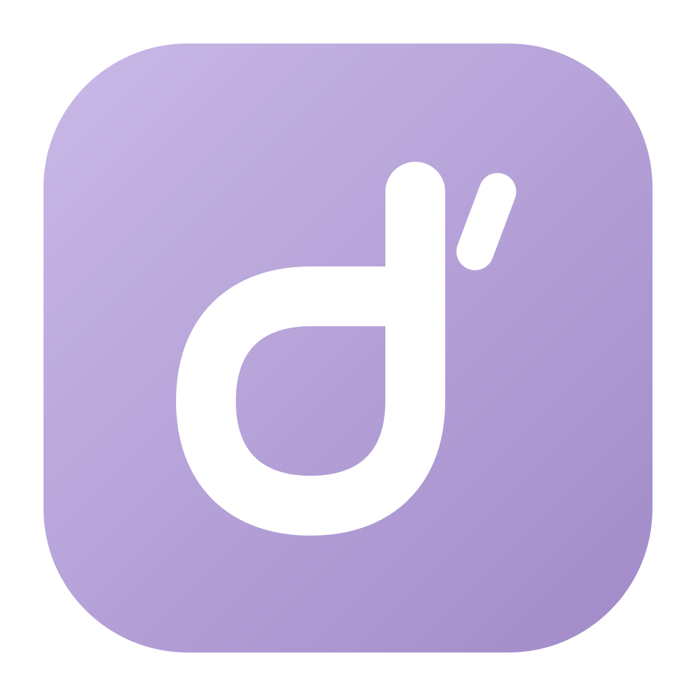
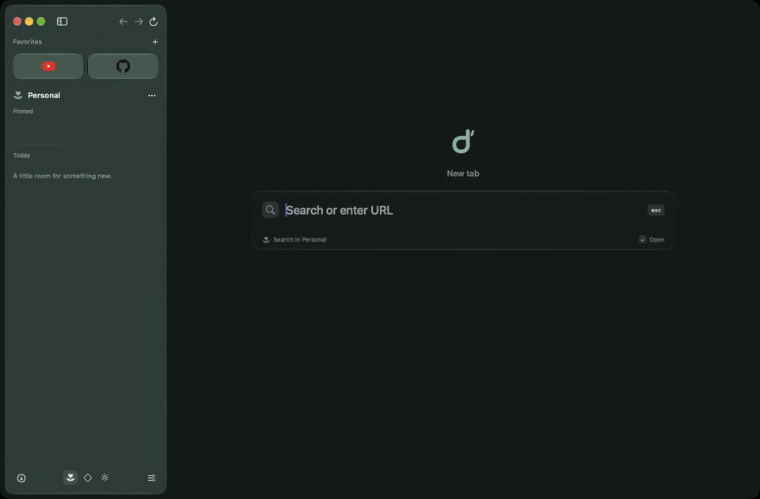

<p align="center">
  
</p>

<h1 align="center">Derivative</h1>
<p align="center">A little space for a curious internet.</p>
<p align="center"><strong>A native macOS browser, powered by Chromium.</strong><br />Inspired by the little things that made Arc feel like home.</p>
<p align="center">
  <a href="#get-started">Get started</a> ·
  <a href="https://derivativebrowser.com">Website</a> ·
  <a href="native/README.md">Build guide</a> ·
  <a href="docs/shortcuts.md">Shortcuts</a> ·
  <a href="docs/architecture.md">Architecture</a>
</p>

---

Derivative (d) is a small, independent browser for macOS. Spaces for different parts of your day. Favorite places within reach. A floating sidebar that gets out of the way. Soft pastel themes and native glass that make it feel at home on your Mac.

**Early development · macOS 14+ · Apple Silicon**

[](assets/demo/derivative.webm)

A short recording of the native app at 1.35× speed. **[Watch WebM](assets/demo/derivative.webm)** · **[Download MP4](assets/demo/derivative.mp4)**

## A little room for everything

| | |
| :--- | :--- |
| **Spaces** | Separate website sign-ins, colors, and favorites. Swipe to switch. |
| **Your favorite places** | Up to 12 favorites per Space. Open favorites have a border; right-click to close their tab while keeping the saved tile. |
| **A quieter sidebar** | Put it on the left or right. Keep it fixed, floating, or hidden, and drag its inner edge to resize. |
| **Search, one shortcut away** | Press **⌘T**, type, and confirm. A new tab opens when you're ready. |
| **Tabs that stay tidy** | Pin tabs, make folders, or clear Today while keeping pinned tabs and favorites. |
| **Two pages together** | Drag one tab onto another for a live, resizable split view. |
| **A little personality** | Lilac, mint, peach, sky, and rose palettes, with light, dark, and system appearance. |

The interface is built with **SwiftUI and AppKit**. Websites run in **Chromium through CEF**. Liquid Glass is available on macOS 26+, with a frosted fallback on earlier systems.

## Get started

You'll need **Python 3.12+** and **Apple's command-line tools** with Swift and C++ support. Install the tools with `xcode-select --install` if needed. This builds with the supplied CEF engine; it does not compile Chromium from source.

```sh
git clone https://github.com/lamdiv/derivative.git
cd derivative
python3 native/scripts/build.py
open "native/build/Derivative.app"
```

The first build downloads the pinned browser engine and build tools. Later builds reuse them. Node.js is needed only for development tests.

For setup details, profile storage, and custom engine builds, see the **[build guide](native/README.md)**.

## Make yourself at home

- **⌘T** — search or open a new tab.
- **⌘L** — edit the current address.
- **⌘S** — show or hide the sidebar.
- **⌘+ / ⌘− / ⌘0** — zoom in, zoom out, or reset. A brief badge shows the percentage.
- **⌘,** — choose your appearance, sidebar position, width, and Space colors.

Drag a favorite into **Pinned** or **Today** to put its open page in that section while keeping the saved favorite. Drag it onto a Space icon to move the saved favorite between Spaces. Drop onto the middle of another tab to split; use its top or bottom edge to reorder.

Right-click favorites and tabs for their menus. The download button at the bottom of the sidebar opens recent downloads. Find every shortcut in **[the shortcut reference](docs/shortcuts.md)**.

## Your browsing, on your Mac

Each Space has separate cookies and website storage. Favorites are separate too; browsing history is shared within the app. There is no built-in sync service.

- **Clear history** also clears recently closed tabs and old browsing sessions in migration backups. Saved favorites and current tabs remain.
- **Clear cookies** removes cookies across Spaces. Other website storage remains, so this may not sign you out of every site.
- **Delete a Space** currently removes its organization and favorites, while retaining its website-data directory.

Website permission prompts identify the requesting site. A granted permission may be remembered. These controls are still being developed; this is not a claim of a completed security audit. See [storage and architecture](docs/architecture.md) for implementation details.

## Still taking shape

Derivative is an early project built around one main window. Extensions, password management, sync, automatic updates, and private browsing are not implemented yet.

The default engine plays **WebM/VP9/Opus**. **H.264/AAC and MP4 streaming are not enabled**, so many MP4 videos and some YouTube livestreams will not play. Codec-enabled Chromium is a separate build that has not been completed. Some sign-in and media services also need further testing. See [media compatibility](native/README.md#video-compatibility-and-engine-builds) for details.

Tabs and organization restore after restarting. Unsaved forms, split arrangements, and download history last for the current session. Builds are locally signed for development; distribution signing and notarization are still required.

## For contributors

The app lives in [`native/Sources`](native/Sources). The [architecture guide](docs/architecture.md) explains how the native interface and Chromium fit together.

```sh
npm ci                 # Node.js 22.12+; test tools only
npm test               # State, engine packaging, and favicon checks
npm run build          # Build the native app
npm run test:integration
```

Run GUI tests sequentially. They use temporary profiles and local webpages. See the [testing guide](native/README.md#verify) and [verification notes](docs/verification.md) for coverage and limits.
